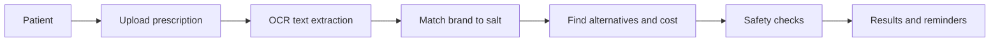

# PillPilot: project documents (edit names, add your numbers)

## 1. Software Requirements Specification
**Purpose.** Help patients in India compare same-salt medicine options, see the cost of a whole course, check safety and follow dose reminders.
**Scope.** Web app for printed or typed prescriptions. It is decision support only; it does not sell or dispense medicines.
**Users.** Patients and caregivers.

**Functional requirements**
- FR1 The user can upload a prescription image or paste text.
- FR2 The system extracts text with OCR (Tesseract).
- FR3 The system parses each line into medicine, frequency and duration, assuming defaults when missing and saying so.
- FR4 The system corrects misspelt brand names (edit distance) and asks the user to confirm uncertain matches.
- FR5 The system lists alternatives with the same salt, strength and form, with price per unit and course cost.
- FR6 The system shows the cost as prescribed, the cheapest valid combination, and the saving.
- FR7 The system warns about duplicate salts, known interactions and drugs needing a doctor's check.
- FR8 The system shows a dose schedule (morning, afternoon, night) for each medicine.

**Non-functional requirements.** Response within 2 s for typed text; no prescription image stored after extraction; clear wording that the tool is not medical advice; runs in Docker.
**Constraints.** Sample price data with a date, not live pharmacy feeds; no handwriting support.

## 2. Use cases (draw as UML use-case diagram)
Actor: Patient. Use cases: Upload prescription; Review and confirm matches; View alternatives and cost; View safety warnings; View dose schedule.

Paste the mermaid code into mermaid.live to export an image.

## 3. Design
Modules: app.py (web layer), core.py (parsing, edit distance, trie, heap, costing, safety), data.csv (medicine data), evaluate_ocr.py, benchmark.py.
Algorithms: Levenshtein dynamic programming O(n*m); trie lookup O(L); size-K max-heap top-K O(N log K); basket costing greedy per medicine (choices are independent, so it is optimal).

## 4. Agile plan (1 semester, 4 sprints)
Sprint 1 requirements and dataset. Sprint 2 parsing and matching. Sprint 3 OCR, costing and safety. Sprint 4 testing, Docker and report.

## 5. Test cases (fill the Actual column after running)
| ID | Input | Expected | Actual | Pass |
|---|---|---|---|---|
| T1 | Tab Dolo 650 1-0-1 x 5 days | Dolo 650, 10 units, cheapest Jan Aushadhi Paracetamol 650 | | |
| T2 | Tab Azitral 500 OD x 3 days | Matched to Azithral 500 with "please confirm" | | |
| T3 | Brufen 400 and Voveran 50 together | Two-NSAID warning | | |
| T4 | Pan 40 with Thyronorm 50 | Pantoprazole + levothyroxine warning | | |
| T5 | Line with no frequency | 1-0-1 and 5 days assumed, shown to user | | |
| T6 | Tab Zzzq 9 BD | "Not recognised" message | | |
| T7 | Same salt twice (Dolo 650 and Crocin 500) | Duplicate salt alert | | |
| T8 | Empty text | No crash, no results | | |
| T9 | Upload typed prescription image | Text extracted and analysed | | |

## 4. Results to report
OCR: run evaluate_ocr.py and paste precision, recall and F1.
DAA (measured here on 20,000 brands): trie exact lookup about 100x faster than linear scan (0.0025 ms vs 0.26 ms). Heap and full sort take similar time for top-3 matching because edit distance dominates; the heap uses O(K) memory instead of O(N). Re-run on your laptop and use your own numbers.

## 5. Risk analysis
| Risk | Impact | Mitigation |
|---|---|---|
| OCR misreads a medicine | Wrong suggestion | Edit-distance matching, "please confirm" prompt, unrecognised lines are never guessed |
| Prices outdated | Wrong savings | Date-labelled public data, shown as estimates |
| Unsafe swap | Patient harm | Only same salt, strength and form; doctor-check flags; on-screen disclaimer |
| Missing or incomplete dataset | Unrecognised medicines | Clear "not recognised" message; dataset can be extended |
| Privacy of prescriptions | Data exposure | Images are processed in memory and never saved |
| Handwritten prescriptions | Poor OCR | Declared out of scope (future work) |

## 6. Limitations and future work
Handwriting, live pharmacy prices, a larger verified drug database and interaction checking by pharmacists.
